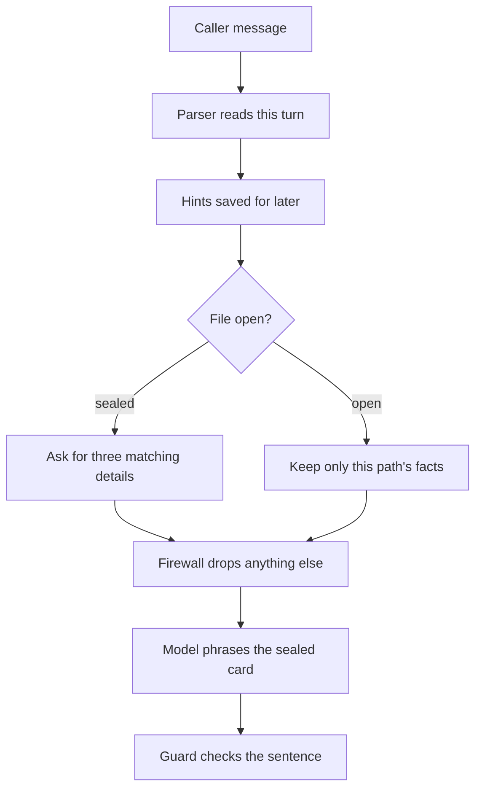

# Claims Desk

**Try it:** [https://insurance-sop-agent-zmss.onrender.com/](https://insurance-sop-agent-zmss.onrender.com/)

Avery answers claim calls. Python decides whether the file is sealed, which claim is open, and whether a letter goes in the tray. The model only reads messy wording and phrases the reply. Paste your own API key in the left panel (the free Render instance can take a minute to wake). With no key at all, Avery says the model is not configured and the call does not move.

## One turn



Three details have to match before any claim fact is spoken: full name, date of birth, phone, email, or last 4 of an SSN or government ID. The policy number only finds the account. A hint said too early (“denied healthcare claim from January”) is kept and used after the file opens, so Avery does not ask the caller to start over.

Payment figures stay off the card unless the caller asked about status or amount. Anger changes the tone. It does not unseal the file. “What is RL?” is declined; a third off-topic try, or frustration with no progress, transfers the call. Someone calling for the policyholder waits on `fixtures/representatives.json` and the consent script. Reciting Margaret’s date of birth does not verify David.

When the caller is done, Avery offers a summary to the masked address on file, or a skip. Only a yes writes the letter tray.

## Run with Docker

From this directory:

```bash
cp .env.example .env
```

Put a key in `.env` if you want the model to phrase replies.

**Claude / Anthropic:**

```bash
LLM_PROVIDER=claude
ANTHROPIC_API_KEY=sk-ant-...
# or: LLM_API_KEY=sk-ant-...
# optional: LLM_MODEL=claude-haiku-4-5-20251001
```

**OpenAI:**

```bash
LLM_PROVIDER=openai
OPENAI_API_KEY=sk-...
# or: LLM_API_KEY=sk-...
```

**Other hosts** (OpenAI-compatible chat completions): set `LLM_PROVIDER` to `openrouter`, `ollama`, `groq`, `together`, `deepseek`, `mistral`, `gemini`, or `fireworks`, or keep `openai` and set `LLM_BASE_URL` yourself. Provider-specific keys such as `OPENROUTER_API_KEY` and `GOOGLE_API_KEY` are accepted.

```bash
docker compose up --build
```

Open http://localhost:8000. If that port is taken:

```bash
APP_PORT=8010 docker compose up --build
```

`GET /healthz` reports `provider`, `transport`, `model`, `host`, and `llm_configured`. A 401, 403, or 404 from the model host returns a setup notice and does not change the call.

## Deploy on Render

1. Push this repo to GitHub (do not commit `.env`).
2. On [Render](https://dashboard.render.com): **New → Web Service** → connect the repo.
3. Use **Docker** runtime, Dockerfile at the repo root.
4. You do not need to put an API key on Render. Each visitor picks a provider and model on the page and pastes their own key. The key stays in that browser tab and is sent only with their messages. It is not saved in the session database.
5. Optional server key (local Docker, or a private demo): `LLM_PROVIDER`, `ANTHROPIC_API_KEY` or `LLM_API_KEY`, and `LLM_MODEL`. A visitor key overrides it for that turn.
6. Deploy. The container listens on `$PORT` (Render sets this; locally it defaults to `8000`).
7. Open the service URL, paste a key, and check `/healthz`.

This project’s public demo: [https://insurance-sop-agent-zmss.onrender.com/](https://insurance-sop-agent-zmss.onrender.com/)

Sessions use SQLite under `DATA_DIR`. On free Render that disk is ephemeral unless you attach a persistent Disk at `/srv/data`.

Before a reply reaches the caller, an output guard blocks claim leaks and false “you're verified” lines, requires a mismatch statement and human offer when those flags are set, checks remaining-factor counts, and rejects invented case ids after verification. A hard violation regenerates once, then falls back to the templated reply.

Sample calls, including the frustrated caller who demands the denial before verifying, are in [docs/walkthroughs.md](docs/walkthroughs.md). The longer turn picture, with transfer and the letter tray, is in [docs/design.md](docs/design.md).

| Button | What to expect |
| --- | --- |
| **Margaret’s denial** | Verifies, opens `CL-2048`, explains the denial from the record without re-asking. |
| **Representative consent** | David for Margaret; consent pending, then approved on the next turn (or times out with the Consent script). |
| **Frustrated caller** | Stays in Verify; no claim facts; empathy only. |
| **Partial ID** | Name alone; still asks for more factors. |
| **Out of scope** | Declines “What is reinforcement learning?” |
| **Wrap up** / **Email yes** / **Email no** | Use after a case is open: offer → send to the masked address, or skip. |

After Margaret’s denial, try “What documents do I need to send and by when?”, then **Wrap up** and **Email yes**. The letter tray shows the three-part summary.

Sessions are stored in `./data` and survive a container restart. Run either Compose or a local server, not both at once, because they share that database. The API never returns raw date of birth, phone, email, or last-4. The stored transcript shows `[DATE]`, `[PHONE]`, `[EMAIL]`, and `[ID4]`.

## Run without Docker

```bash
python -m venv .venv
source .venv/bin/activate
pip install -r requirements.txt
uvicorn app.main:app --reload
```

## Tests

Use the project venv so Anaconda’s global `pytest` (and plugins like napari) do not get loaded:

```bash
python -m venv .venv
source .venv/bin/activate
pip install -r requirements.txt
python -m pytest -q
```

Or without activating:

```bash
.venv/bin/python -m pytest -q
```

If the prompt shows both `(.venv)` and `(base)`, run `conda deactivate` first, or always call `.venv/bin/python -m pytest -q`. The suite uses a fake model and does not need a key or a network connection.

### Live scenario runner

With the server up and a key configured (server `.env` or visitor env vars):

```bash
.venv/bin/python scripts/live_demo.py
.venv/bin/python scripts/live_demo.py --scenario demo_caller --verbose
```

For a BYOK deploy with no server key:

```bash
export CLAIMS_LLM_PROVIDER=groq
export CLAIMS_LLM_MODEL=openai/gpt-oss-120b
export CLAIMS_LLM_API_KEY=gsk_...
.venv/bin/python scripts/live_demo.py --base-url https://your-service.onrender.com
```

## Settings

| Variable | Default | Purpose |
| --- | --- | --- |
| `LLM_PROVIDER` | `openai` | `openai` or `anthropic` |
| `LLM_API_KEY` | empty | Token for the model host |
| `LLM_MODEL` | provider default | Override when a model name returns 404 |
| `LLM_BASE_URL` | provider default | OpenAI-compatible base URL |
| `MAX_VERIFY_ATTEMPTS` | `3` | Mismatches before a person is offered. One more mismatch transfers. |
| `MAX_OFF_TOPIC` | `3` | Off-topic turns before transfer |
| `MAX_FRUSTRATION_TURNS` | `3` | Frustrated turns with no progress before transfer |
| `TRACE_ENABLED` | `true` | Include the turn decision list in the API response |
| `APP_PORT` | `8000` | Host port published by Compose |

## Layout

```
app/
  main.py              FastAPI + BYOK endpoints
  sop/
    engine.py          Turn loop (extract → decide → phrase → guard)
    directives.py      Shared directive builders
    phases/            VERIFY_ID, RESOLVE_INTENT, PROCESS_CASE, POST_PROCESS
    parse.py           Deterministic field reading
    firewall.py        Seal claim facts before the model speaks
    guard.py           Output guard
    phrases.py         Templated fallbacks
  eval/                Shared offline + live scenario definitions
  llm/                 Multi-provider client + NullLLM
  static/              Claims-desk UI
fixtures/              Policyholders, claims, guidelines, representatives, consent
scripts/live_demo.py   Live PASS/FAIL runner (needs a running server + key)
tests/                 Offline suite (FakeLLM / NullLLM, no network)
docs/                  design, walkthroughs, behaviour-spec, transcripts
docker/                Entrypoint that keeps the data directory writable
```

## Documentation

- [docs/design.md](docs/design.md) — the turn picture, firewall, identity, memory, emotion, consent.
- [docs/walkthroughs.md](docs/walkthroughs.md) — how to run the demo, including the frustrated caller.
- [docs/behaviour-spec.md](docs/behaviour-spec.md) — each rule, the code that enforces it, and the test that pins it.
- [docs/transcripts.md](docs/transcripts.md) — expected calls, phase by phase.
