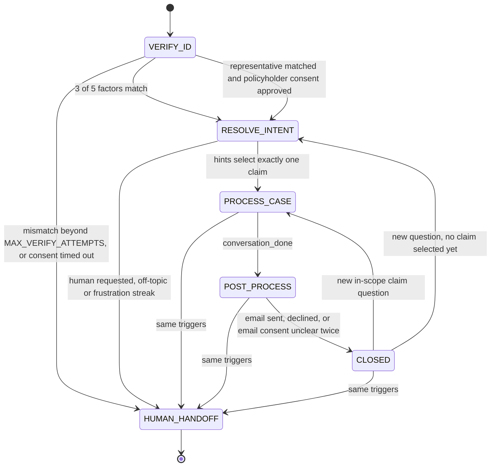

# Design

How Claims Desk keeps a fixed claims procedure and still talks like a person. The short front page is the [README](../README.md). How to run a call is in [walkthroughs](walkthroughs.md). Every rule mapped to code and a test is in [behaviour-spec](behaviour-spec.md). Worked conversations are in [transcripts](transcripts.md).

## Terms

- **Phase.** The step the call is in: `VERIFY_ID`, `RESOLVE_INTENT`, `PROCESS_CASE`, `POST_PROCESS`, `CLOSED`, or `HUMAN_HANDOFF`.
- **Directive.** The controller's instruction for one reply: goal, facts the model may use, the question it must ask, forbidden topics, tone, and a templated fallback.
- **Firewall.** A pass that runs *before* the model phrases the reply. It removes claim fields the current phase and path are not allowed to discuss. The output guard still checks the words that come back.
- **Path.** One of six labels for what the caller is asking once a claim is open: denial question, status inquiry, document submission, next steps, appeal, general claim question. The path chooses which claim fields are visible. It does not add a new phase.
- **Memory.** Intent hints, case hints (type, status, month, year, case id), and email preference. They can be stored in any phase and used later.
- **Letter tray.** The mock outbox. A summary is written there only after the caller agrees in `POST_PROCESS`. Nothing is sent over real email.

## Architecture

Each caller turn:

1. If no server key and no visitor key, return the not-configured notice and leave the call unchanged.
2. Read the message with the deterministic parser (`app/sop/parse.py`). The model may fill gaps. It cannot erase a value the parser already found, and an identity value counts only if the caller typed it on this turn.
3. Update memory, scope streak, and emotion.
4. Run phase handlers until one of them needs the caller (`app/sop/phases/`). One utterance can cross verify, intent, and case.
5. Seal the directive (`app/sop/firewall.py`).
6. Ask the model to phrase that directive. The output guard checks the draft, regenerates once on a hard violation, then uses the template.



| Phase | Freedom | What reaches the model | What Python decides |
| --- | --- | --- | --- |
| `VERIFY_ID` | Strict | No claim fields. How many factors matched, which kinds are still acceptable, whether this turn mismatched, whether to offer a person. | Match factors against the fixture. Policy number locates the account and does not count. |
| `RESOLVE_INTENT` | Flexible | One-line briefs of the caller's claims (id, type, date, status). No denial text, documents, or amounts. | Pick the claim when remembered hints leave exactly one. Otherwise ask. |
| `PROCESS_CASE` | Flexible, grounded | Only the fields for the current path, plus matching guideline lines. Payment figures only on a status question the caller actually asked. | Which claim is open, which path, and that the answer must stay inside those facts. |
| `POST_PROCESS` | Choice | Masked address on file, whether anything has been sent (`sent: false` until it has). | Offer, send, skip, or close after two unclear answers. |
| `CLOSED` | Minimal | Whether a summary is already in the tray. | Warm close. A new claim question reopens the file. |
| `HUMAN_HANDOFF` | Terminal | Nothing. Later turns use a fixed queue line and do not call the model. | Transfer reason and whether identity was verified. |

## How the gates work

### Identity, 3 of 5

Acceptable factors: full name, date of birth, phone, email, last 4 of SSN or government ID. Three must match the policyholder on file. A mismatch clears that slot, counts one attempt, and after `MAX_VERIFY_ATTEMPTS` the reply offers a person. One further mismatch transfers.

Partial answers stay in `VERIFY_ID`. Clarifying questions ("what do you mean?") stay in scope. Alternate fields are always listed. Anger changes the tone. It does not open the file.

Worked case: "I already told you who I am. This is ridiculous. Just tell me why my claim was denied." The desk stays in `VERIFY_ID`, acknowledges the frustration, explains that the file stays sealed, and offers the allowed details. It does not name a denial reason, a document, or a case id.

### Memory across phases

"Denied healthcare claim from January," said before verification, is stored as case hints. After the gate, those hints select `CL-2048` for Margaret Chen. "January" alone matches more than one of her claims, so the desk asks which file unless status or type narrows it.

### Scope

Questions that are not claims service ("What is RL?", "What is reinforcement learning?") are declined. The off-topic streak resets when the caller returns to a claim. At `MAX_OFF_TOPIC` (default 3) the call transfers.

### Emotion

The parser labels anger, frustration, anxiety, confusion, and refusal. The directive carries an empathy line the reply must include. A streak of negative turns with no progress (no new matched factor, no phase change, no in-scope claim answer) transfers at `MAX_FRUSTRATION_TURNS`.

### Firewall, then output guard

The firewall runs first:

- Before verification, claim ids, denial text, documents, and dollar amounts are removed from the directive.
- After verification, `claim` is cut down to `PATH_FIELDS` for the current path.
- Guidance lines that mention a dollar amount are dropped unless the path is `status_inquiry`.
- The model cannot relabel a turn as `status_inquiry` unless the caller asked about status, payment, or amount. A path the parser already chose is kept.

The guard then checks the drafted sentence: claim leak, false "you're verified," missing mismatch wording, missing human offer, wrong remaining-factor count, invented case id or amount, a false "I sent the summary," and a stale consent request. A hard flag regenerates once, then the template is used.

### PII

The stored transcript, model history, and API state use `[DATE]`, `[PHONE]`, `[EMAIL]`, and `[ID4]`. Raw values stay in session slots and are not returned. Email goes only to the address on file, shown masked (`m*****@email.com`). A different address typed by the caller is declined.

### Failure handling

| Situation | What the caller gets | Call state |
| --- | --- | --- |
| No key | Fixed "language model is not configured" notice | Unchanged |
| Key rejected (401, 403, 404) | Setup notice naming the status | Unchanged |
| Transport error on extract | Stay on the current step | Unchanged |
| Empty or unsafe phrasing | Phase template | Decision already made by Python still stands |

## Representative consent

A caller on someone else's behalf is matched on their own name and the policyholder's name in `fixtures/representatives.json`. Relationship is recorded, not matched. "On behalf of my mother, Margaret Chen" counts.

Consent comes from `fixtures/consent_scenarios.json` and advances one step per caller turn. The default script is pending, then approved. The timeout script stays pending, then transfers. The policyholder's date of birth or last-4, recited by the representative, does not verify them.

## Decisions

- Python owns phase order, the identity gate, claim selection, consent, email send, and escalation. The model extracts and phrases.
- Facts are sealed before phrasing, not only scanned afterwards.
- A visitor key is per request and is scrubbed from the response. It is not written to the session database.
- The summary email is built from memory and the claim record, in three parts: what we discussed, claim status, next steps.
- English only. Thresholds are settings (`MAX_VERIFY_ATTEMPTS`, `MAX_OFF_TOPIC`, `MAX_FRUSTRATION_TURNS`).

## Layout

```
app/sop/engine.py       turn loop
app/sop/parse.py        deterministic reading
app/sop/firewall.py     seal the directive
app/sop/guard.py        check the drafted reply
app/sop/phases/         verify, resolve, process, email
app/sop/phrases.py      templates
app/eval/               scenarios shared by pytest and scripts/live_demo.py
```

## API

- `POST /api/session` with optional `consent_scenario` (`default` or `timeout`).
- `POST /api/session/{id}/message` with `message` and optional `llm_provider`, `llm_model`, `llm_api_key`, `llm_base_url`.
- `GET /healthz` reports provider, model, host, `llm_configured`, and `bring_your_own_key`.
- `GET /api/providers` and `POST /api/llm/check` list models for a visitor key and probe it. A missing model is switched to one the key can use.

When `TRACE_ENABLED` is true, each turn includes `debug.decisions`, a masked extraction, guard flags, and the directive's fact keys.
